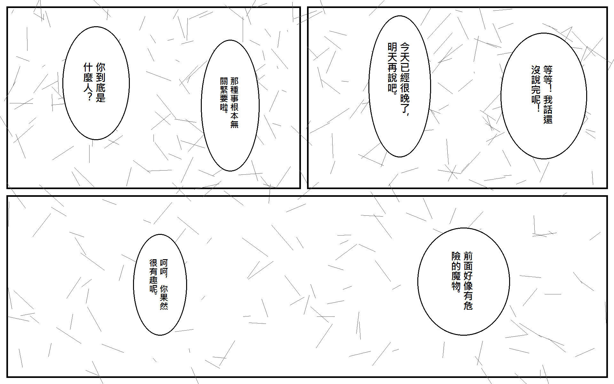
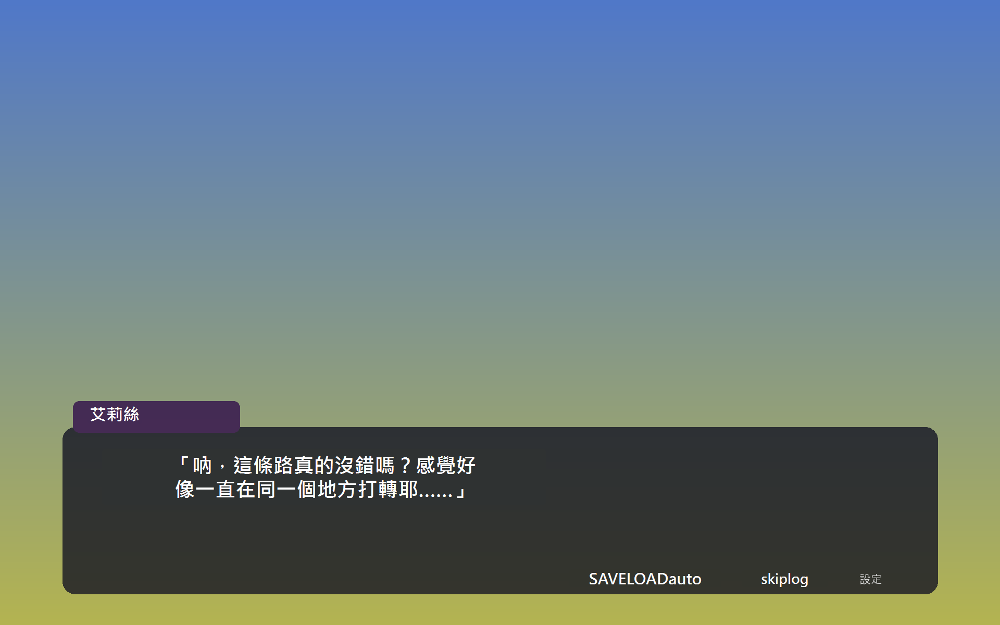
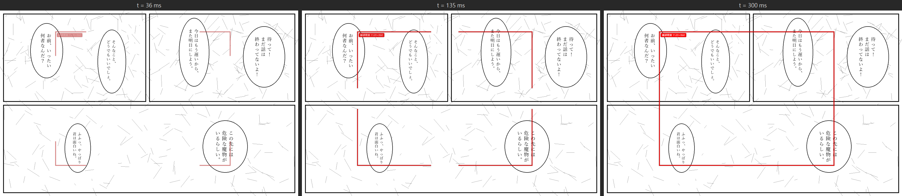
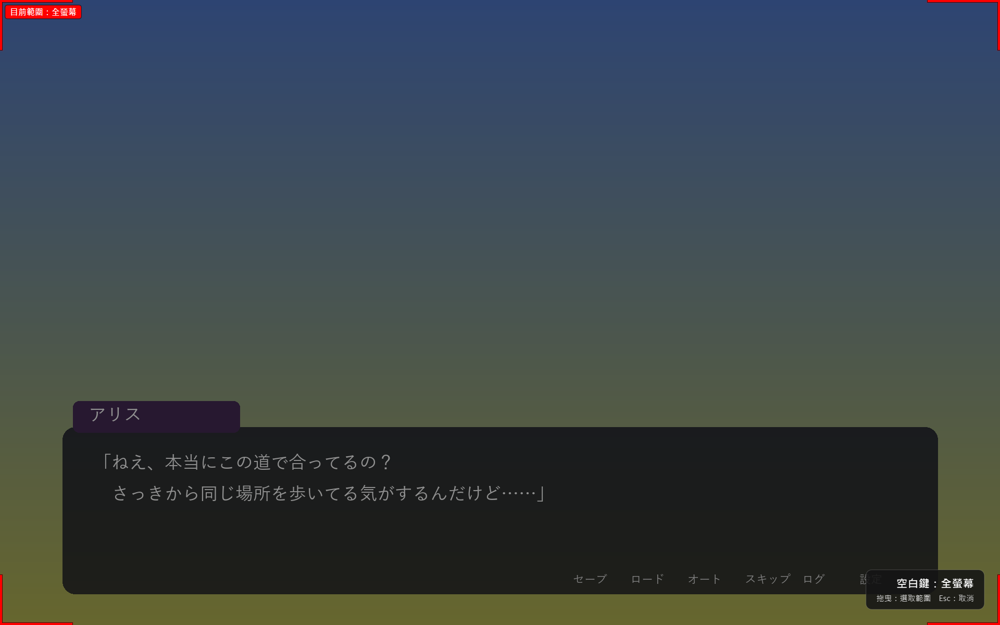

# 即時日翻中螢幕覆蓋翻譯

Windows 上的本地即時翻譯工具：自動偵測螢幕（全螢幕或指定範圍）上的日文——漫畫直排、遊戲橫排都可以——翻成繁體中文，並直接蓋在原文的位置上。全程在本機執行，不連網、不需要 API 金鑰。

| 漫畫（直排氣泡） | 遊戲（對話框） |
|---|---|
|  |  |

（以上為程式實際執行的截圖；測試圖片是程式產生的假漫畫／假遊戲畫面，原文為日文。）

```
截圖(mss) → 變化偵測 → OneOCR(偵測+辨識, CPU) → 分組成對話框/氣泡 → 翻譯(平行, 快取, 上下文) → 透明覆蓋層(截圖時隱形)
```

## 系統需求
- Windows 11（需要內建的「剪取工具」，OCR 引擎取自其中；請先從 Microsoft Store 更新到最新版）
- Python 3.11（`py -3.11` 可用）
- LLM 引擎：NVIDIA 顯示卡，建議 8 GB 顯示記憶體（6 GB 也可）。沒有 NVIDIA 顯示卡可改用非 LLM 引擎（CPU）。
- 約 6 GB 磁碟空間（加裝非 LLM 引擎另需約 1.3 GB）

## 安裝 / 啟動
1. `powershell -ExecutionPolicy Bypass -File setup.ps1`（建 venv、從本機「剪取工具」複製 OCR 引擎、下載 llama.cpp 與模型 ~4.6 GB）
   - 也要非 LLM 引擎：`setup.ps1 -WithNmt`（另外下載轉換 mt5-game-large，暫存約 6 GB，完成後自動刪除）
2. 雙擊 `start.bat` → 螢幕最上方中央出現浮動工具列（3 秒後自動收成一條細把手），右下角系統匣有「譯」圖示。模型載入約 5–10 秒（工具列第一顆按鈕的小圓點變綠），之後畫面上出現日文就自動翻譯覆蓋，不需要框選。
   - 想看即時記錄：`start.bat --console`。詳細記錄（含原文/譯文）在 `logs\app.log`。
   - 工具列、譯文覆蓋層、記錄視窗都不會被截圖（避免程式自己翻到自己），所以用截圖工具也截不到它們。

## 浮動工具列
滑鼠移到螢幕最上方中央停一下就會滑出來，移開自動收起（收起時的把手不擋滑鼠點擊）。


| 圖示 | 功能 |
|---|---|
| ⏸ / ▶（右下小圓點：綠=翻譯中、橘=載入中、灰=暫停、紅=錯誤） | 暫停／開始翻譯 |
| 👁 | 隱藏／顯示譯文（看原文） |
| 紅色四角框＋十字 | 滑鼠停在上面：用紅框漸進顯示目前翻譯範圍；點一下：進入選取模式（拖曳選範圍、**空白鍵＝全螢幕**、Esc 取消） |
| ↻ | 換作品時：清除上下文、人名術語、快取 |
| ⚙ | 選單：翻譯引擎、上下文模式、固定顯示工具列、翻譯記錄與狀態、結束 |

| 滑鼠停在範圍圖示：紅框漸進顯示目前範圍 | 選取模式（空白鍵＝全螢幕） |
|---|---|
|  |  |

## 翻譯引擎（工具列 ⚙ 可即時切換）
| 引擎 | 1 句 | 一整頁 | 品質 |
|---|---|---|---|
| LLM：Sakura-GalTransl 7B（顯示卡） | 0.3–0.5 秒 | ~0.9 秒 | 好，懂語氣與上下文 |
| 非 LLM：mt5-game-large（CPU） | ~0.3 秒 | ~1.1 秒 | 大意約 7 成對，語氣平淡 |
| 非 LLM：opus-mt（CPU，改 config） | ~0.02 秒 | ~0.06 秒 | 常錯意 |

本機上 LLM 不比非 LLM 慢，建議用 LLM；玩吃顯示卡的大型遊戲時可切到非 LLM（用 CPU，不搶顯示卡）。

## 熱鍵（可在 config.json 改）
| 熱鍵 | 功能 |
|---|---|
| Ctrl+Alt+T | 翻譯 開/關 |
| Ctrl+Alt+H | 暫時隱藏譯文（看原文） |
| Ctrl+Alt+R | 選取翻譯範圍（拖曳；空白鍵＝全螢幕；會記住，下次自動用） |
| Ctrl+Alt+F | 回到全螢幕 |
| Ctrl+Alt+C | 換作品時用：清除上下文、自動術語表、快取 |
| Ctrl+Alt+Q | 結束 |

## 上下文一致性（自動）
- **先快後準**：一頁有多個新氣泡時，先每個氣泡平行快速翻（~1 秒出現），同時把「整頁（依閱讀順序：漫畫右→左、上→下）＋之前的翻譯歷史＋術語表」一次送給模型重翻，結果出來後直接替換畫面上的譯文（~2–3 秒）。
- **單句**（遊戲對話推進）：直接帶完整歷史與術語表翻一次，不需二次。
- **自動術語表**：片假名名詞、帶 さん/くん/様 的人名、遊戲名字框，出現 ≥2 次就固定一個譯名，之後每次都套用 → 人名前後一致。存在 `data/context.json`，重開仍有效。
- **手動術語表**：在專案根目錄建 `glossary.txt`，每行 `原文->譯名 #備註`（例：`アリス->艾莉絲 #女主角`），優先於自動術語表。
- `config.json` 的 `context.mode`：`refine`（預設，先快後準）/ `batch`（只整頁翻，首字較慢但不會換字）/ `single`（逐句帶歷史）。

## 實測速度（本機：RTX 5060 Laptop 8GB / Ryzen AI 7 350, 1920×1200）
| 階段 | 時間 |
|---|---|
| 截圖 + 變化偵測 | 17 ms |
| OCR 整張漫畫頁（直排 6 個氣泡） | ~140 ms |
| OCR 遊戲畫面（對話框） | ~140 ms |
| 分組 | < 1 ms |
| 翻譯 1 句（LLM） | ~0.5 s |
| 翻譯 8 句平行（LLM） | ~0.9 s |
| 已翻過的文字（快取） | 立即 |

→ 換頁到譯文出現：漫畫一頁約 1.1 s，遊戲一句約 0.65 s。

## 設定（config.json，只需寫要改的鍵）
- `region`: `null` = 整個螢幕；或 `[x0, y0, x1, y1]`（實體像素）。
- `engine`: `"llm"`（Sakura-GalTransl 7B，品質好）或 `"nmt"`（非 LLM 小模型，更快但品質較差）。
- `output`: `"s2twp"` 台灣繁中用語 / `"s2t"` 繁中 / `null` 簡中。
- `llm.glossary`: 人名術語表，每行 `原文->譯名 #備註`。
- `detect.require_kana`: 只翻含假名的文字（避免翻到中文/英文介面）。

## 限制
- 「獨佔全螢幕」遊戲無法覆蓋，請改用「無邊框視窗」模式。
- 漫畫中藝術字／手寫狀聲詞、極小字可能辨識不到。
- 遊戲選單等相鄰的短詞可能被合成一段翻譯，片假名外來語有時會被譯回英文。
- 只支援單一螢幕（主螢幕或 `config.json` 的 `monitor` 指定的螢幕）。

## 授權與第三方元件
本專案程式碼採用 [MIT License](LICENSE)。以下元件**不包含在本儲存庫中**，由 `setup.ps1` 在你的電腦上取得，各自適用其授權：

| 元件 | 用途 | 授權／說明 |
|---|---|---|
| Windows 剪取工具 OCR（oneocr.dll 等） | 文字偵測與辨識 | Microsoft 專有軟體；從使用者本機已安裝的剪取工具複製，僅供本機使用，**請勿散布** |
| [llama.cpp](https://github.com/ggml-org/llama.cpp) | LLM 推論 | MIT |
| [Sakura-GalTransl-7B v3.7](https://huggingface.co/SakuraLLM/Sakura-GalTransl-7B-v3.7) | 日翻中 LLM | CC BY-NC-SA 4.0（**禁止商用**） |
| [mt5-translation-ja_zh-game-large](https://huggingface.co/iryneko571/mt5-translation-ja_zh-game-large)（選用） | 非 LLM 翻譯 | 依模型頁面授權 |
| [OpenCC](https://github.com/BYVoid/OpenCC) | 簡轉繁（台灣用語） | Apache-2.0 |
| [PySide6 / Qt](https://www.qt.io/qt-for-python) | 介面 | LGPL-3.0 |
| [mss](https://github.com/BoboTiG/python-mss)、[CTranslate2](https://github.com/OpenNMT/CTranslate2) | 截圖、非 LLM 推論 | MIT |

OneOCR 的呼叫方式參考了社群的公開研究（如 [b1tg/win11-oneocr](https://github.com/b1tg/win11-oneocr)）。

## 工具
- `tools/bench_ocr.py` OCR 速度 / 結果
- `tools/llm_quality.py` 翻譯品質抽查（不需啟動伺服器）
- `tools/llm_context_check.py` 驗證模型遵守術語表、整頁翻譯行數不亂
- `tools/test_pipeline.py` 主迴圈 + 上下文邏輯測試（無 GUI）
- `tools/test_textfix.py` OCR 修正測試（刪節號被認成 000/00o/○ 等，且不誤改真正的數字）
- `tools/demo_overlay.py` 覆蓋層排版／截圖隱形／DPI 對位測試
